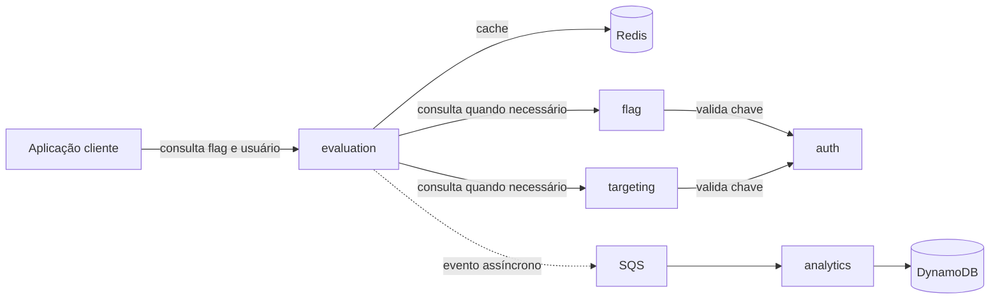

# ToggleMaster — projeto central da Fase 4

> **Última atualização:** 15/11/2026

O ToggleMaster é uma plataforma de **feature flags**: ela permite controlar a
liberação de funcionalidades para usuários sem publicar uma nova versão da
aplicação a cada mudança de regra. Este projeto reúne a aplicação, infraestrutura
AWS, implantação Kubernetes, automação de entrega e artefatos de observabilidade.

Este README é o **ponto de entrada** para entender o projeto, escolher entre
execução local e AWS e seguir a ordem das etapas. Para comandos detalhados,
verificações e encerramento seguro, use o
[Guia de Execução da Fase 4](docs/Fase4_Guia_de_Execucao.md). Não execute
os blocos de todo o guia de uma só vez: valide cada etapa antes de avançar.

> **Situação:** os arquivos representam uma solução de laboratório e não
> comprovam implantação ou funcionamento na AWS. A observabilidade e a
> resposta a incidentes da Fase 4 ainda exigem ajustes e demonstração.
> Veja [situação e pendências](#situação-e-pendências-da-fase-4).

## Menu

- [Visão geral](#visão-geral)
- [Arquitetura e funcionamento](#arquitetura-e-funcionamento)
- [Estrutura do projeto](#estrutura-do-projeto)
- [Pré-requisitos](#pré-requisitos)
- [Preparar o projeto](#preparar-o-projeto)
- [Roteiro de execução](#roteiro-de-execução)
  - [Execução local](#execução-local)
  - [Execução na AWS e Kubernetes](#execução-na-aws-e-kubernetes)
  - [GitOps e CI/CD](#gitops-e-cicd)
  - [Observabilidade](#observabilidade)
- [Situação e pendências da Fase 4](#situação-e-pendências-da-fase-4)
- [Segurança, custos e encerramento](#segurança-custos-e-encerramento)
- [Diagnóstico rápido](#diagnóstico-rápido)
- [Documentação complementar](#documentação-complementar)

## Visão geral

O projeto evolui uma aplicação de cinco microsserviços para um ambiente
conteinerizado e automatizado. A Fase 4 acrescenta o objetivo de observar
métricas, logs e traces e responder a incidentes.

| Componente | Tecnologia | Porta | Finalidade |
|---|---|---:|---|
| [auth](services/auth-service/README.md) | Go, PostgreSQL | 8001 | Cria e valida chaves de API. |
| [flag](services/flag-service/README.md) | Python/Flask, PostgreSQL | 8002 | Gerencia definições de funcionalidades. |
| [targeting](services/targeting-service/README.md) | Python/Flask, PostgreSQL | 8003 | Gerencia regras de segmentação. |
| [evaluation](services/evaluation-service/README.md) | Go, Redis | 8004 | Avalia uma flag para um usuário e envia eventos quando SQS está configurado. |
| [analytics](services/analytics-service/README.md) | Python/Flask, SQS, DynamoDB | 8005 | Consome eventos e os armazena para análise. |

As portas indicadas são as portas dos containers e, no Compose, também as
portas de acesso local. No Kubernetes, os Services podem usar outras portas.

## Arquitetura e funcionamento



Uma equipe cadastra uma flag e sua regra. `evaluation` consulta o Redis e, em
caso de ausência no cache, busca a flag e a regra nos serviços correspondentes,
que validam a chave com `auth`. A lógica atual suporta regras de
**porcentagem**, com distribuição determinística por usuário e flag. O cache
de informações dura 30 segundos, portanto uma alteração pode demorar até esse
intervalo para aparecer.

Quando configurado, `evaluation` envia um evento à fila SQS de forma
assíncrona; `analytics` o processa e grava no DynamoDB. O envio pode falhar
sem alterar a resposta HTTP, portanto uma resposta bem-sucedida não garante
que o evento foi armazenado. A fila tem uma *dead-letter queue* para mensagens
que excedem o limite de tentativas.

Na AWS, o Terraform declara rede, EKS, três bancos RDS PostgreSQL, Redis no
ElastiCache, SQS, DynamoDB e cinco repositórios ECR. O Kubernetes executa os
containers; ArgoCD e GitHub Actions possuem configurações para entrega
declarativa. Os arquivos não demonstram, por si só, que o ambiente está ativo.

## Estrutura do projeto

```text
FIAP-Postech-Cloud/
├── README.md                 # Entrada e roteiro do projeto
├── docs/                     # Guia de execução, visão executiva e desafio
├── services/                 # Cinco serviços, Dockerfiles e Docker Compose
├── terraform/                # Bootstrap do state S3 e módulos de infraestrutura
├── k8s/                      # Deployments, Services, GitOps e monitoramento
├── scripts/                  # Policy e script IAM de provisionamento
├── .github/workflows/        # Pipelines por serviço
└── eks/                      # Configuração EKS complementar/histórica
```

Os manifests em `k8s/` incluem namespaces, ConfigMaps, Deployments, Services,
Gateway, HPA, KEDA, ArgoCD e monitoramento. Alguns contêm valores específicos
de uma conta ou ambiente: **revise antes de aplicar**.

## Pré-requisitos

| Objetivo | Necessário |
|---|---|
| Ler e versionar | Git e acesso aos arquivos deste projeto. |
| Rodar localmente | Docker Engine ou Docker Desktop com Compose v2 e `curl`; no WSL, Docker integrado à distribuição Linux. |
| Provisionar AWS | Conta e orçamento autorizados, AWS CLI v2, Terraform **1.10 ou superior**, `kubectl`, Docker, `eksctl`, `jq`, `openssl`, Python 3 e credenciais adequadas. |
| GitOps e observabilidade no EKS | Helm 3, ArgoCD, cluster com capacidade, EBS CSI, StorageClass e permissões configurados. |

O guia detalhado pressupõe Bash em Ubuntu/WSL e AWS CLI 2.32.0 ou posterior
para `aws login`. Confira as versões, a região e as cotas atuais da AWS antes
de provisionar; o exemplo de Terraform não garante disponibilidade das versões
ou tipos de instância.

## Preparar o projeto

Se ainda não tiver uma cópia deste repositório, clone-a e entre na raiz:

```bash
git clone https://github.com/claytonlfonseca/FIAP-Postech-Cloud.git
cd FIAP-Postech-Cloud
```

Se já possui uma cópia, entre na pasta que contém `services/`, `terraform/`
e `k8s/`. A partir dela:

```bash
export PROJECT_ROOT="$PWD"
test -d "$PROJECT_ROOT/services" && test -d "$PROJECT_ROOT/terraform" \
  && test -d "$PROJECT_ROOT/k8s" && echo "Raiz do projeto válida"
```

As variáveis do shell valem apenas para o terminal atual. Ao abrir outro
terminal, retorne à raiz e defina `PROJECT_ROOT` novamente.

## Roteiro de execução

Escolha **local** para conhecer e testar as APIs, ou prossiga para **AWS/EKS**
quando precisar do fluxo com infraestrutura e mensageria reais. O teste local
é recomendado antes da AWS, mas não é um pré-requisito técnico obrigatório.

### Execução local

1. Confirme que Docker está iniciado e que as portas necessárias estão livres.
2. Na raiz do projeto, construa e inicie os containers:

   ```bash
   docker compose -f "$PROJECT_ROOT/services/docker-compose.yml" up -d --build
   docker compose -f "$PROJECT_ROOT/services/docker-compose.yml" ps
   ```

3. Consulte os endpoints de saúde dos cinco serviços:

   ```bash
   for port in 8001 8002 8003 8004 8005; do
     echo "Porta $port:"
     curl --fail-with-body --show-error "http://localhost:$port/health" || break
     printf '\n'
   done
   ```

   A resposta esperada é `{"status":"ok"}`. Uma resposta de saúde não
   comprova todas as dependências ou o fluxo de negócio. Se falhar, consulte
   `docker compose -f "$PROJECT_ROOT/services/docker-compose.yml" logs`.

4. Para testar funcionalidades, siga os exemplos individuais de
   [auth](services/auth-service/README.md), [flag](services/flag-service/README.md),
   [targeting](services/targeting-service/README.md) e
   [evaluation](services/evaluation-service/README.md), nessa ordem.
   Crie uma chave, uma flag e uma regra antes de avaliar. Reutilize nomes
   apenas se souber que os dados existentes não conflitam.
5. Ao terminar, pare os containers:

   ```bash
   docker compose -f "$PROJECT_ROOT/services/docker-compose.yml" down
   ```

O Compose inclui dois PostgreSQL, Redis, DynamoDB Local e serviços de
telemetria. O SQS fica desabilitado por padrão; esse modo **não valida** o
fluxo SQS → analytics → DynamoDB da AWS. DynamoDB Local está configurado em
memória. O comando `down` preserva os volumes PostgreSQL; removê-los apaga
os dados. As credenciais e configurações locais são apenas exemplos de
laboratório, não devem ser usadas em ambientes compartilhados ou produção.

### Execução na AWS e Kubernetes

O procedimento completo está no [Guia de Execução](docs/Fase4_Guia_de_Execucao.md).
Ele explica as decisões e os comandos de cada passo:

1. **Conta e identidade:** defina região, autentique na AWS e confirme conta
   e ARN; não use root para provisionar. Se necessário, um administrador pode
   avaliar o [script IAM](scripts/grant-togglemaster-iam.sh), que concede
   permissões elevadas para laboratório e só cria policy nova após confirmação.
   Se a policy já existir, o script não a atualiza nem a anexa.
2. **State Terraform:** crie o bucket de backend pelo bootstrap apenas se
   ainda não existir um state correspondente. Preserve o state local do
   bootstrap; o state remoto também pode conter dados sensíveis.
3. **Infraestrutura:** copie e revise
   [`terraform.tfvars.example`](terraform/terraform.tfvars.example), confirme
   versão EKS, capacidade, região e nomes, inicialize o backend correto e
   revise o `terraform plan` antes do `apply`. O backend contém valores
   históricos; informe explicitamente bucket e região do seu ambiente.
4. **Cluster e armazenamento:** conecte `kubectl` ao EKS correto e valide os
   nodes. Prepare e valide EBS CSI e StorageClass `gp3` antes dos componentes
   que precisam de volumes persistentes.
5. **Imagens e identidades:** publique imagens nas cinco entradas ECR com tags
   novas; configure OIDC/IRSA e as permissões dos pods conforme os recursos da
   conta. Não use credenciais AWS permanentes em Secrets Kubernetes.
6. **Aplicação:** configure endpoints e Secrets para o ambiente atual,
   inicialize os schemas PostgreSQL e implante os serviços. Não aplique os
   manifests estáticos de Secrets antigos.
7. **Validação:** crie uma flag e uma regra, avalie uma requisição e confirme
   o evento no DynamoDB, seguindo as seções de teste do guia. Verifique também
   logs, estado dos pods e permissões.
8. **Entrega e observabilidade:** prepare GitOps, Collector e monitoramento
   conforme as próximas seções. Para atender ao desafio, complete e demonstre
   também as [pendências](#situação-e-pendências-da-fase-4).
9. **Encerramento:** preserve o que for necessário e remova os recursos na
   ordem descrita no guia, inclusive recursos criados fora do Terraform.

### GitOps e CI/CD

Os [workflows GitHub Actions](.github/workflows/) contêm etapas de
preparação/build, análise de código e segurança, criação e publicação de
imagens e atualização de manifests. As etapas variam por serviço: a existência
de um job não comprova que testes foram executados ou que o pipeline passou.
Revise triggers, credenciais, permissões e resultados antes de usá-los.

As [Applications ArgoCD](k8s/argocd/) descrevem a sincronização dos manifests
e charts. Ajuste repositório, branch, caminhos e imagens para o ambiente e
publique as mudanças no Git remoto: o ArgoCD não sincroniza alterações apenas
locais. Evite dois reconciliadores controlando os mesmos objetos.
Implantação manual pode ser útil para diagnóstico, mas **GitOps é parte do
desafio**.

### Observabilidade

O projeto contém manifests para Prometheus, Grafana, Loki, Promtail,
OpenTelemetry Collector, Jaeger, dashboard e regras de alerta. Os cinco
serviços possuem instrumentação de traces; o Collector também declara
exportação para Datadog, sujeita à configuração de credenciais e à validação
no ambiente.

Antes de concluir que o monitoramento funciona:

- Revise os [ServiceMonitors](k8s/monitoring/prometheus-service-monitor.yaml):
  usam `/actuator/prometheus`, que não corresponde automaticamente às
  aplicações Go/Flask. Adeque métricas, portas e seletores e confirme os targets.
- O painel que menciona requisições usa pacotes de rede, não uma contagem de
  requisições HTTP. Ajuste a métrica e valide dashboard e alertas com dados reais.
- Promtail está configurado para enviar logs diretamente ao Loki. Isso não
  comprova o requisito de encaminhar métricas, logs e traces pelo Collector.
- Confira compatibilidade das versões e exporters, endpoints, Secrets e
  acesso ao APM. Jaeger é útil para traces, mas não substitui o APM comercial
  solicitado pelo desafio.

Detalhes de implantação estão nas seções de
[monitoramento e Collector do guia](docs/Fase4_Guia_de_Execucao.md#16-instalar-monitoramento-opcional).
O guia chama essa etapa de opcional para uma implantação manual; ela é
**necessária para a entrega da Fase 4**.

## Situação e pendências da Fase 4

Conforme o [enunciado](docs/POSTECH%20-%20Tech%20Challenge%20-%20Fase%204.pdf),
a entrega deve demonstrar a aplicação automatizada, monitoramento,
OpenTelemetry, APM comercial, alertas, gestão de incidentes, ChatOps e
self-healing. A tabela representa o que foi encontrado no projeto, não uma
verificação ao vivo.

| Área | Estado e ação necessária |
|---|---|
| Aplicação, IaC e entrega | Código e configurações presentes; validar execução, pipelines e GitOps no ambiente. |
| Métricas e logs | Há dashboard e manifests; corrigir a coleta e demonstrar dados reais. |
| Collector e APM | Há instrumentação e configuração para Datadog; validar métricas, logs e traces, além do mapa dos cinco serviços no APM. |
| Alertas e incidentes | Há regras declaradas; validar disparo e integrar PagerDuty ou OpsGenie e um canal de equipe. |
| Self-healing | Não foi identificada automação de remediação acionada por alerta; implementar e demonstrar. O `selfHeal` do ArgoCD, isoladamente, não cumpre esse requisito. |
| Entregáveis | Produzir vídeo de até 25 minutos e relatório PDF com identificação, links, justificativas e evidências reais conforme o enunciado. |

Consulte a [visão executiva](docs/Fase4_Visao_Executiva.md) para a matriz
detalhada de requisitos e prioridades.

## Segurança, custos e encerramento

- **Custo:** EKS, nodes, NAT Gateway, bancos, cache, volumes e tráfego podem
  gerar cobrança enquanto existirem. Fechar o terminal ou interromper o Docker
  local não remove recursos AWS.
- **Segredos:** não versione senhas, chaves, DSNs, arquivos de state ou planos.
  Revise configurações de exemplo, incluindo credenciais do Grafana, antes de
  compartilhar ou sincronizar qualquer ambiente.
- **Dados:** valide permissões, retenção e privacidade de logs e eventos que
  possam conter identificadores de usuários.
- **Exclusão:** faça backup, identifique o state correto e revise o plano de
  destruição. Remova recursos criados fora do Terraform e somente depois
  considere excluir o backend. O bootstrap permite exclusão forçada do bucket
  e suas versões; o ECR também pode excluir imagens.

Siga o [encerramento completo](docs/Fase4_Guia_de_Execucao.md#17-encerramento-completo-e-prevenção-de-cobranças)
e confirme os recursos restantes e a cobrança na conta.

## Diagnóstico rápido

| Sintoma | Primeira verificação |
|---|---|
| Container local não inicia | Confira `docker compose ... ps` e os logs, portas ocupadas e saúde dos bancos. |
| `ImagePullBackOff` | Verifique conta/região ECR, tag, arquitetura da imagem e acesso dos nodes. |
| Erro de acesso a SQS/DynamoDB | Confira URL, região, ServiceAccount, IRSA e policies. |
| PVC `Pending` | Verifique EBS CSI, IAM, StorageClass `gp3`, zona e eventos do PVC. |
| Sem métricas dos serviços | Confira endpoint, porta, labels, ServiceMonitors e targets Prometheus. |
| Sem traces | Confira configuração OTLP dos serviços, Collector, endpoints e logs de exportação. |
| ArgoCD não sincroniza | Revise acesso ao Git remoto, branch, caminho, Application e eventos. |

Para comandos de investigação, consulte
[verificações e diagnóstico](docs/Fase4_Guia_de_Execucao.md#14-verificações-gerais-de-saúde-e-diagnóstico).

## Documentação complementar

| Documento | Quando consultar |
|---|---|
| [Guia de Execução da Fase 4](docs/Fase4_Guia_de_Execucao.md) | Sequência detalhada de preparação, implantação, testes e limpeza. |
| [Visão executiva](docs/Fase4_Visao_Executiva.md) | Arquitetura explicada, requisitos do desafio e lacunas. |
| [Enunciado oficial](docs/POSTECH%20-%20Tech%20Challenge%20-%20Fase%204.pdf) | Requisitos e critérios de entrega. |
| [Serviços](services/README.md) e READMEs individuais | Execução local e detalhes de APIs; relatos e exemplos históricos devem ser conferidos contra o código atual. |
| [Terraform](terraform/README.md) | Módulos, state e recursos AWS; confira os valores atuais em `terraform.tfvars.example`. |
| [Início rápido de monitoramento](k8s/monitoring/QUICKSTART.md) | Pré-requisitos, instalação e verificação do stack no Kubernetes. |
| [Referência de monitoramento](k8s/monitoring/README.md) | Componentes e diagnóstico; há trechos históricos de Spring Boot que não se aplicam diretamente aos serviços Go/Flask. |
