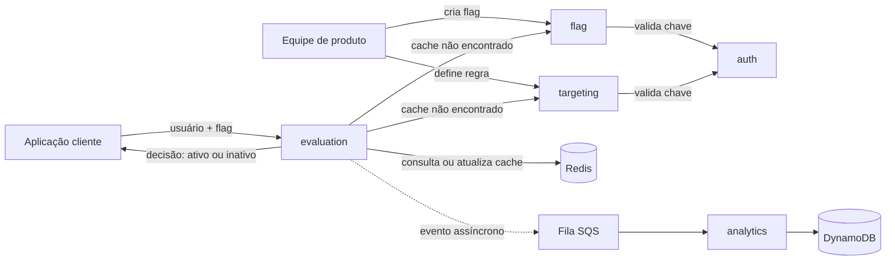
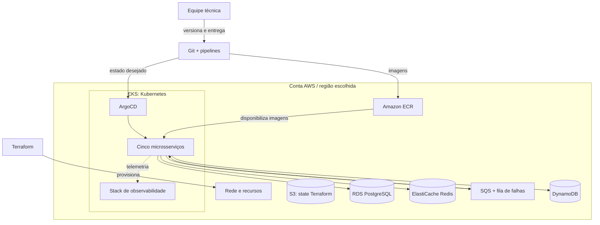
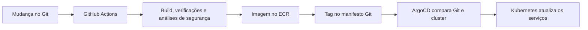
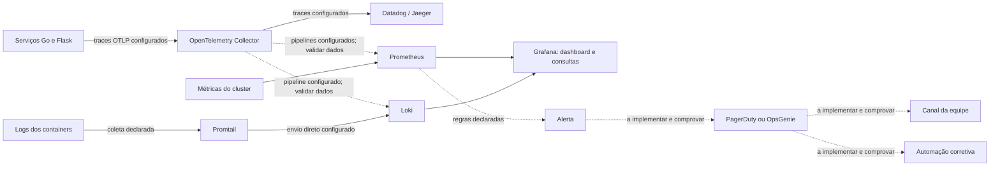

# ToggleMaster — visão executiva da Fase 4

> **Última atualização:** 15/11/2026

**Público:** gestores, avaliadores e integrantes da equipe.  
**Base da análise:** documentos, código e configurações presentes nesta cópia
do projeto, consultados em novembro de 2026.

> **Leitura importante:** este documento descreve o que o projeto pretende
> fazer e o que foi encontrado no repositório. A existência de um arquivo não
> comprova que ele esteja implantado ou funcionando na AWS. A Fase 4 **ainda
> exige validações e entregas adicionais**, detalhadas adiante.

## 1. Resumo executivo

O **ToggleMaster** é uma plataforma de *feature flags*: ela permite decidir se
uma funcionalidade de um software ficará ativa para determinado usuário, sem
depender de uma nova publicação da aplicação a cada alteração de regra.

Por exemplo, uma equipe pode cadastrar uma funcionalidade e ativá-la para 20%
dos usuários. O serviço de avaliação devolve uma decisão para cada usuário;
eventos dessas decisões podem ser enviados para análise posterior.

O projeto reúne:

- **Cinco microsserviços** que administram chaves, funcionalidades, regras,
  decisões e eventos.
- **Infraestrutura como código** com Terraform para criar os recursos AWS,
  incluindo o cluster Kubernetes, bancos, cache e fila.
- **Entrega automatizada** com definições de pipelines GitHub Actions e
  implantação declarativa por ArgoCD.
- **Observabilidade em construção:** arquivos para Prometheus, Grafana, Loki,
  OpenTelemetry Collector e integração com Datadog, além de instrumentação
  de traces nos serviços.

A Fase 4 transforma a plataforma de uma solução que **entrega software** em
uma solução que também precisa **perceber falhas, explicar suas causas,
notificar responsáveis e reagir automaticamente**. A base está representada no
repositório, mas o conjunto completo não está comprovado apenas por ele.

## 2. O que o desafio pede

O [enunciado oficial](./POSTECH%20-%20Tech%20Challenge%20-%20Fase%204.pdf)
parte de um incidente no qual o serviço de avaliação falhou silenciosamente,
houve aumento de consumo de recursos e a equipe demorou a descobrir o problema.
A proposta é construir uma resposta operacional mais rápida:

1. **Manter a base das fases anteriores:** serviços em containers,
   infraestrutura Terraform, CI/CD com práticas DevSecOps e Kubernetes com
   GitOps.
2. **Observar métricas e logs:** Prometheus, Loki e Grafana no Kubernetes,
   incluindo dashboard próprio de saúde, requisições e logs.
3. **Padronizar a telemetria:** usar OpenTelemetry Collector como ponto central
   para receber, processar e encaminhar métricas, logs e traces.
4. **Investigar o caminho de uma requisição:** instrumentar os serviços e
   demonstrar traces distribuídos e mapa dos cinco serviços em **Datadog ou
   New Relic**.
5. **Responder a incidentes:** alerta, abertura automática em **PagerDuty ou
   OpsGenie**, notificação em canal de equipe e automação de *self-healing*.

Além do código, a avaliação exige **vídeo de até 25 minutos** e **relatório
em PDF** com identificação da equipe, links, justificativas e evidências
visuais. A configuração deve ser demonstrada em funcionamento, não apenas
descrita.

## 3. Como o produto funciona

### Cinco responsabilidades, uma decisão

| Serviço | Responsabilidade | Tecnologia |
|---|---|---|
| **auth** | Cria e valida chaves de acesso usadas pelas APIs protegidas. | Go + PostgreSQL |
| **flag** | Mantém as definições das funcionalidades e seu estado. | Python/Flask + PostgreSQL |
| **targeting** | Mantém as regras de segmentação associadas às flags. | Python/Flask + PostgreSQL |
| **evaluation** | Decide se a flag se aplica ao usuário e usa cache para reduzir consultas. | Go + Redis |
| **analytics** | Consome eventos de avaliação e os grava para análise posterior. | Python/Flask + SQS + DynamoDB |

**Como ler:** as setas contínuas representam consultas e respostas; o evento
segue separadamente, sem bloquear a resposta HTTP. O diagrama simplifica as
conexões e não indica que todos os componentes estejam implantados agora.

Na implementação atual:

1. A equipe cadastra uma flag e uma regra usando APIs protegidas por chave.
2. A aplicação cliente consulta `evaluation` com o usuário e a flag.
3. `evaluation` verifica o Redis; em caso de ausência, consulta `flag` e
   `targeting` usando sua chave de serviço. Esses serviços consultam `auth`.
4. A regra de **porcentagem** usa uma distribuição determinística: para o
   mesmo usuário e a mesma flag, o resultado é consistente enquanto a regra e
   o estado não mudarem. O cache das informações tem validade de 30 segundos,
   portanto alterações podem não aparecer imediatamente.
5. A resposta é devolvida e o evento é enviado de forma assíncrona à fila,
   quando configurada. `analytics` grava o evento no DynamoDB e remove a
   mensagem da fila após o processamento bem-sucedido. Mensagens com falhas
   podem ser reprocessadas e, após tentativas, encaminhadas à fila de falhas
   (*dead-letter queue*).

**Limites relevantes:** o avaliador implementa porcentagem; regras por país ou
outros atributos mencionadas em documentos antigos não são demonstradas na
lógica atual. O envio assíncrono pode falhar sem alterar a resposta ao
cliente; não há garantia de entrega exata de todos os eventos. O Redis é cache,
não substituto dos bancos de origem.

## 4. Onde a solução funciona

### Na AWS

O Terraform organiza os recursos em módulos:

- **Rede:** VPC, sub-redes, rotas e acesso de saída; os componentes de dados e
  os nodes são planejados para sub-redes privadas.
- **EKS:** cluster Kubernetes, grupo de nodes e roles para execução dos
  containers. Cada serviço possui seus próprios manifests e namespace.
- **Dados:** três instâncias RDS PostgreSQL para `auth`, `flag` e `targeting`;
  ElastiCache Redis para cache; DynamoDB para eventos.
- **Mensageria e imagens:** fila SQS com fila de falhas e cinco repositórios
  ECR para as imagens dos serviços.
- **Estado da infraestrutura:** bucket S3 criado por um bootstrap Terraform
  separado, com versionamento e bloqueio de acesso público.

Kubernetes organiza e reinicia containers e pode escalar réplicas conforme as
configurações. Há manifests de **HPA** para serviços e de **KEDA** para
escalonamento por fila. A aplicação desses recursos, a instalação de seus
controladores e o ajuste de conta, região e URL da fila precisam ser
conferidos no ambiente real; os arquivos, por si só, não comprovam que o
escalonamento esteja ativo.

O EBS CSI e a StorageClass `gp3`, preparados no guia de execução, fornecem
armazenamento persistente aos componentes de monitoramento que o exigem.

### No computador da equipe

O [Docker Compose](../services/docker-compose.yml) permite executar os cinco
serviços com PostgreSQL, Redis e DynamoDB Local. Ele também declara componentes
de telemetria local. Nesse modo, a URL do SQS está vazia por padrão: o teste
local **não comprova** o percurso de eventos SQS → analytics → DynamoDB da AWS.
O DynamoDB Local configurado em memória não substitui persistência em produção.

## 5. Como o software chega ao ambiente

Existem workflows por microsserviço com etapas de build ou preparação,
análise estática, verificações de segurança, imagem de container, publicação
no ECR e atualização de manifesto. As etapas e garantias variam entre
workflows: por exemplo, a etapa Python chamada `build-and-test` instala
dependências, mas não executa testes no arquivo de `flag`; não se deve
interpretar seu nome como prova de cobertura de testes.

O ArgoCD acompanha o Git para reconciliar o estado declarado com o cluster.
Antes de usá-lo, é necessário conferir o repositório remoto, branch, caminhos,
credenciais, imagens e escopo das Applications. Alterações apenas locais não
são consumidas pelo ArgoCD até serem publicadas no Git remoto. O guia permite
implantação manual, mas **GitOps é exigido pelo desafio**.

## 6. Observabilidade: entender o que acontece

| Informação | Pergunta respondida | Ferramentas previstas |
|---|---|---|
| **Métricas** | Quanto, com que frequência e quão rápido? | Prometheus e Grafana |
| **Logs** | Que acontecimentos e erros foram registrados? | Promtail, Loki e Grafana |
| **Traces** | Por quais serviços uma requisição passou e onde demorou? | OpenTelemetry, Jaeger e Datadog configurado |
| **Alertas** | Quando uma condição requer atenção? | Regras Prometheus e Alertmanager |

**Linhas tracejadas** representam caminhos configurados que precisam ser
validados ou integrações ainda não encontradas nesta cópia. O diagrama não
afirma que todos os dados já circulam.

Os cinco serviços contêm código de instrumentação de traces; há propagação de
contexto entre chamadas HTTP e, no fluxo assíncrono, através de atributos das
mensagens SQS. Os manifests do Collector declaram exportadores para Datadog e
Jaeger, um endpoint de métricas Prometheus e envio de logs ao Loki. A
integração Datadog exige configuração e Secret apropriados no ambiente.

**Diferença para o objetivo do desafio:** a configuração também declara
Promtail enviando logs diretamente ao Loki. Portanto, não é possível afirmar
que *todos* os logs passam pelo Collector. Os serviços encontrados exportam
traces, mas as métricas e logs de aplicação passando pelo Collector precisam
ser instrumentados/configurados e demonstrados.

Há um dashboard e regras declarados, porém os ServiceMonitors apontam para
`/actuator/prometheus`, uma convenção Spring Boot que não corresponde
automaticamente aos serviços Go/Flask; os Services também precisam ter portas
e seletores compatíveis. É necessário corrigir ou adaptar a coleta e validar
as métricas, os painéis e os alertas com dados reais. O painel que menciona
requisições usa atualmente **pacotes de rede**, não contagem de requisições
HTTP; ele não comprova a taxa de requisições pedida pelo desafio.

## 7. Situação frente aos requisitos da Fase 4

**Critério de leitura:** “presente” significa encontrado no código ou em
manifesto, não instalado nem aprovado. “Pendente” indica trabalho ou evidência
que não foi identificada nesta análise local.

| Requisito | Situação observada | O que falta demonstrar ou concluir |
|---|---|---|
| Cinco serviços, containers e Terraform | Código, Dockerfiles e módulos presentes. | Provisionamento, serviços saudáveis e fluxo ponta a ponta no ambiente. |
| CI/CD, DevSecOps e GitOps | Workflows e Applications ArgoCD presentes. | Execução efetiva dos pipelines e sincronização correta; revisar testes e fontes Git. |
| Prometheus, Loki, Grafana e dashboard | Charts, configuração e dashboard declarados. | Implantação, métricas e logs reais; corrigir incompatibilidade dos ServiceMonitors. |
| Collector central para métricas, logs e traces | Collector e pipelines declarados; traces instrumentados nos cinco serviços. | Confirmar compatibilidade e entrega dos três sinais; adequar coleta para que logs e métricas exigidos passem pelo Collector. |
| APM comercial e mapa dos cinco serviços | Configuração de exportação para Datadog presente. | Credenciais, conectividade, traces distribuídos e service map efetivo no APM. Jaeger, sozinho, não substitui o APM comercial solicitado. |
| Alerta inteligente | Existem regras declaradas, inclusive taxa de erro. | Métricas compatíveis, regras carregadas e alerta disparando em teste controlado. |
| Gestão de incidentes e ChatOps | Não foi identificada integração completa nesta cópia. | Escolher e configurar PagerDuty ou OpsGenie e canal Slack, Discord ou Teams; comprovar incidente e notificação. |
| Self-healing por alerta | Não foi identificada automação de remediação acionada pelo alerta. | Criar e demonstrar reação segura, controlada e auditável ao incidente. |
| Vídeo e relatório | Enunciado descreve as entregas; este documento é uma visão executiva. | Gravar demonstração e produzir relatório PDF com identificação, links, justificativas e evidências reais. |

O `selfHeal: true` nas Applications do ArgoCD significa reconciliar alterações
no estado declarado no Git; **não equivale**, por si só, à automação de
remediação acionada pelo alerta exigida no desafio.

## 8. Prioridades para concluir e apresentar

1. **Comprovar a base:** verificar EKS, serviços, bancos, fila, imagens,
   pipelines e Applications ArgoCD. Demonstrar uma decisão e o evento
   persistido no DynamoDB.
2. **Fazer a coleta funcionar:** adequar métricas dos serviços, ServiceMonitors,
   portas e seletores; validar o dashboard, consultas ao Loki e fluxo dos
   sinais pelo Collector.
3. **Comprovar tracing e APM:** configurar Datadog ou New Relic; gerar
   requisições e evidenciar o trace distribuído e o mapa dos cinco serviços.
   Um cache hit pode evitar chamadas aos serviços de origem; planeje o teste
   para percorrer as dependências.
4. **Fechar o ciclo de incidente:** ligar uma regra funcional à ferramenta de
   incidentes e ao canal da equipe; implementar a remediação automática,
   limitar permissões e demonstrar o resultado com segurança.
5. **Reunir evidências:** capturar dashboard, trace no APM, notificação e
   execução da automação; produzir o relatório PDF e o vídeo exigidos.

Para a prova de incidente, use ambiente de laboratório, defina responsáveis,
janela de teste e procedimento de retorno. O exemplo de falha deve disparar
o alerta selecionado e permitir observar tanto a notificação quanto a ação
corretiva, sem expor credenciais.

## 9. Riscos e decisões de gestão

- **Custo:** EKS, nodes, NAT Gateway, RDS, Redis, EBS, tráfego e outros
  recursos podem ser cobrados mesmo sem usuários. Orçar, acompanhar e
  destruir os recursos ao final; parar o terminal não encerra a cobrança.
- **Segurança:** a policy de provisionamento é ampla e destinada a
  laboratório; usar credenciais temporárias e acesso mínimo. Não publicar
  Secrets, state Terraform ou senhas. Há configurações de exemplo que
  precisam ser substituídas antes de compartilhar o ambiente.
- **Resiliência:** há componentes de laboratório com configurações simples;
  disponibilidade, backup, recuperação, retenção e limites precisam de
  projeto e validação adicionais para produção.
- **Dados e privacidade:** eventos e traces podem conter identificadores de
  usuários; definir coleta mínima, retenção, acesso e descarte adequados.
- **Resultados:** dashboards, alertas, traces e automações dependem de
  integração efetiva, permissões e dados reais. Manifests ou relatos
  históricos não são prova de funcionamento atual.